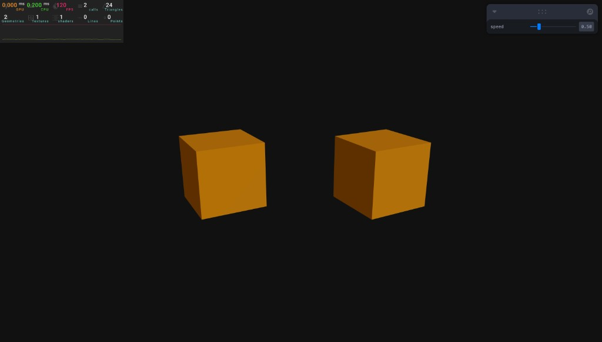

# R3F Playground

A small sandbox for experimenting with [React Three Fiber](https://docs.pmnd.rs/react-three-fiber), Drei, Leva, and Three.js.



## Features

- Interactive meshes — hover to recolor, click to scale
- Orbit camera controls with damping
- Leva GUI slider for rotation speed
- Dev-only `r3f-perf` overlay (FPS, draw calls, GPU/CPU)

## Stack

- React 19 + TypeScript
- Vite
- `@react-three/fiber` + `@react-three/drei` + `three`
- `leva` (controls)
- `r3f-perf` (performance monitor)
- Oxlint

## Getting started

```bash
npm install
npm run dev
```

Then open the local URL Vite prints (default `http://localhost:5173`).

## Scripts

| Command         | Description              |
| --------------- | ------------------------ |
| `npm run dev`   | Start the Vite dev server |
| `npm run build` | Typecheck and production build |
| `npm run preview` | Preview the production build |
| `npm run lint`  | Run Oxlint               |

## Try it

- Drag to orbit, scroll to zoom
- Hover a box → turns hotpink
- Click a box → grows / shrinks
- Tweak **speed** in the Leva panel (top-right)
